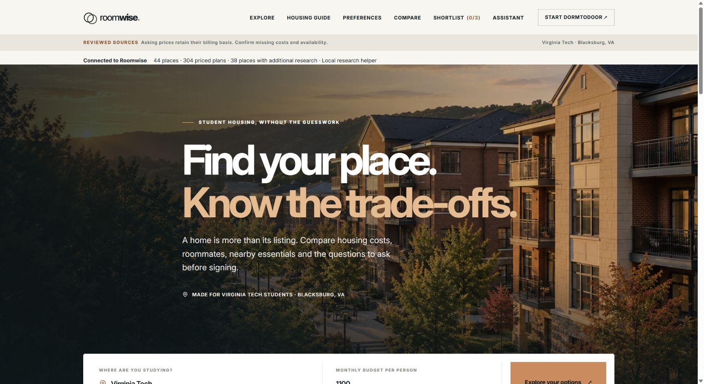
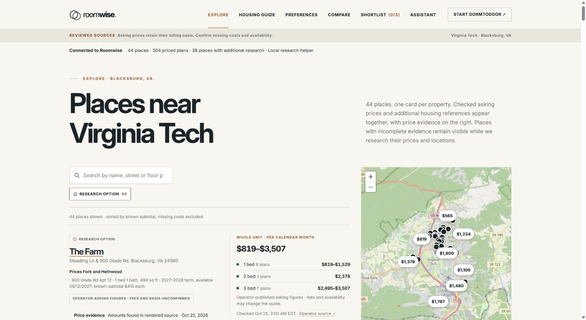
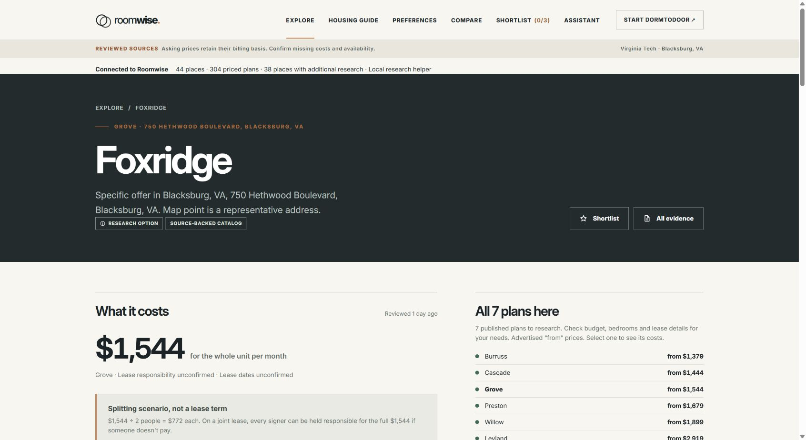
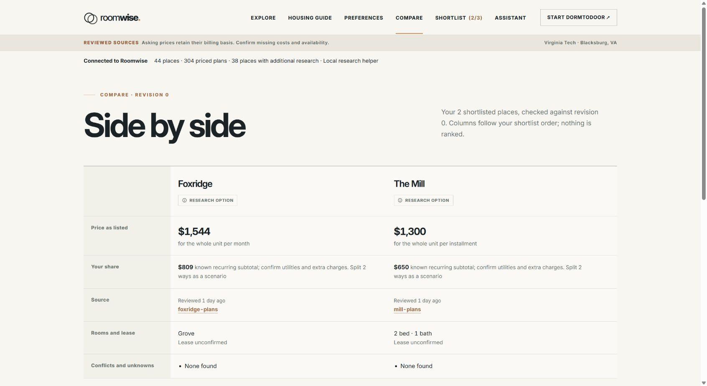
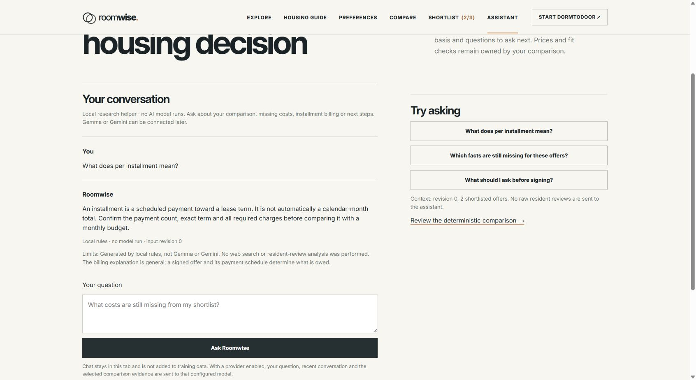
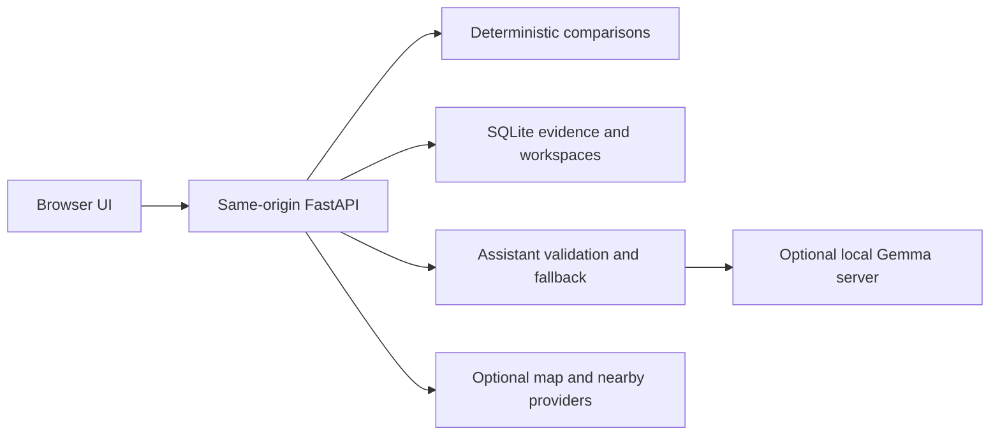

<div align="center">

# Roomwise

### Find your place. Know the trade-offs.

Source-backed housing research for Virginia Tech students, with a locally fine-tuned Gemma 4 assistant.

[](https://github.com/CharanD547/CampusHousing/actions/workflows/ci.yml)
[](LICENSE)
[](models/LICENSE)
[](pyproject.toml)

[Quick start](#quick-start) · [Screenshots](#screenshots) · [Gemma model](#locally-trained-gemma-4) · [Documentation](docs/README.md) · [Pitch & demo](docs/PITCH.md) · [90-second video](docs/demo/roomwise-90-second-walkthrough.mp4) · [Voiceover](docs/demo/VOICEOVER.md)

</div>



## Why Roomwise?

A listing's price might mean **per person**, **the whole apartment**, **per month**, or **one installment**. Utilities, deposits and lease terms can change the comparison again. Roomwise keeps those distinctions visible and helps students turn missing information into specific questions for the leasing office.

**44 priced properties · 304 plans · 47 housing-guide references** in the October 25, 2026 research snapshot. One card represents each property; its plans and price ranges stay together.

> Asking figures are dated research, not live inventory or guaranteed lease quotes. Missing costs stay unknown. Screenshots show an isolated demo workspace; the home illustration is not a photograph of a verified listing.

## What you can do

| Workflow | What Roomwise provides |
|---|---|
| **Explore housing** | Search properties, inspect grouped floor plans, retain billing labels and follow dated source links. |
| **Understand the costs** | Separate recurring charges, refundable deposits and one-time fees. Whole-unit roommate splits are explicit planning scenarios. |
| **Compare a shortlist** | Put up to three plans side by side. Deterministic backend code owns calculations; the model cannot overwrite prices. |
| **Ask the assistant** | Explain selected evidence, renting terminology and unresolved questions using local Gemma or an explicitly labeled rules helper. |
| **Investigate nearby essentials** | Maps, groceries, restaurants, gas stations, cafes, pharmacies and libraries, with mile-based controls and directions links. |
| **Prepare the next step** | Copy a plan-specific written-quote request, work through DormToDoor and save a brief that freezes the comparison evidence. |

## Screenshots

Captured from the running application in visible Chrome on October 25, 2026. The demo uses isolated data, the OpenStreetMap fallback and no paid provider calls. Prices shown are historical asking figures; the assistant screenshot uses the labeled local helper, not a claimed Gemma response.

| Explore: one card per property | Plan details: costs and evidence |
|---|---|
|  |  |

| Compare: known costs and missing facts | Assistant: scoped research help |
|---|---|
|  |  |

[View full-size screenshots and capture notes](docs/images/README.md).

## Quick start

**Requirements:** Python 3.11+, Git and a browser. Basic browsing, comparisons and the local research helper need **no API keys or GPU**. Internet access is needed to install dependencies; fonts, map tiles and optional nearby services also depend on their providers. Node.js is only needed for frontend tests.

```bash
git clone https://github.com/CharanD547/CampusHousing.git
cd CampusHousing
python -m venv .venv
```

Activate the environment:

```powershell
# Windows PowerShell
.\.venv\Scripts\Activate.ps1
```

```bash
# macOS / Linux
source .venv/bin/activate
```

Then, from the repository root:

```bash
python -m pip install -r requirements-dev-lock.txt
python tools/build_frontend.py
python -m uvicorn roomwise.main:app --app-dir src --host 127.0.0.1 --port 8001
```

Open **[Roomwise](http://127.0.0.1:8001/)** · **[API docs](http://127.0.0.1:8001/docs)** · **[Health](http://127.0.0.1:8001/api/v1/health)**.

No frontend package installation is required. FastAPI serves the UI and API together; opening `index.html` directly will not work. If PowerShell activation is unavailable, use `.\.venv\Scripts\python.exe` in place of `python` without changing execution policy.

### Optional configuration

Copy `.env.example` to `.env` **only if `.env` does not already exist**, then edit the settings you need. Keep the real file private. Process environment variables take precedence.

| Capability | Configuration |
|---|---|
| Local single-operator use | Fresh checkout works on loopback with providers disabled. A configured `ROOMWISE_API_TOKEN` must be entered in the browser's backend-token form. |
| Local Gemma | Use the published v2 adapter, a separately obtained base model and the [model-server instructions](docs/AI_AND_TRAINING.md). |
| Google Maps / Places / Routes | Separate keys and explicit enable switches in `.env.example`. Places and Routes share at most **60 web-service attempts per UTC day**; failed attempts count. Browser SDK usage needs separate provider quotas. |
| Accounts or LAN development | Read [operations](docs/OPERATIONS.md) and [LAN access](docs/LAN_DEVELOPMENT.md) before changing the loopback-only setup. |

Google's designated Maps JavaScript key is delivered to the browser by design. Private Places, Routes and model credentials stay server-side. Provider keys are different from the application's backend bearer token.

## Locally trained Gemma 4

The selected runtime is **`roomwise-gemma-4-e4b-v2`**, a LoRA adapter for `google/gemma-4-E4B-it`. Gemma explains scoped evidence and missing terms; arithmetic and catalog amounts remain owned by application code.

| Published artifact | Location |
|---|---|
| Both original synthetic dataset versions | [`data/training/`](data/training/README.md) |
| Actual learned v1, v2 and v3 adapters | [`models/`](models/README.md), about **36.3 MB each** |
| Historical training and generation reports | [`data/training/reports/`](data/training/reports/) |
| Training, serving, evaluation and packaging code | [`tools/training/`](tools/training/) |
| Identity, provenance, safeguards and limitations | [Model card](docs/MODEL_CARD.md) |

The selected model used **240 authored synthetic examples: 192 train / 24 validation / 24 test**. A second version supported the v3 experiment. Versions share templates and may overlap; they are not 480 independent benchmark cases. No resident reviews, user chats or current property rents were used for training.

On the same 24 shared-template generation cases, answer-category correctness was 25% for the base, 58% for v1 and 79% for v2. **These are not factual-accuracy scores.** v3 regressed and remains published for transparency; v2 stays selected.

Tensor and dataset hashes are preserved across Windows checkouts. Adapter configs use a portable base-model identity. Base weights, tokenizer copies, pickle checkpoints and optimizer state are excluded. The measured CUDA recipe uses about **24 GB VRAM**; CPU/quantized inference and a public cloud deployment remain unverified. The application still works without model inference.

## How it fits together



| Path | Responsibility |
|---|---|
| `CampusHousing-main/` | Browser UI, styles and bundled Leaflet; the folder name is retained for existing integrations. |
| `src/roomwise/` | HTTP boundary, services, domain calculations, repositories and provider adapters. |
| `data/` | Versioned housing evidence, source rechecks and public synthetic training/evaluation artifacts. |
| `models/` | Published learned adapters, manifests, model license and notices. |
| `contracts/` | Generated OpenAPI and example integration fixtures. |
| `tests/`, `tools/` | Regression checks, imports, release verification, backups and training utilities. |
| `docs/` | Setup, operations, model card, screenshots, audit history and demo materials. |
| `var/` *(ignored)* | Local databases, private workspaces, research collections, logs and base weights. |

## Development and checks

```bash
python -m pytest -q
node --test tests/frontend_adapter.test.cjs tests/property_map.test.cjs
python tools/build_frontend.py
python tools/backend/export_contracts.py
```

The last local verification passed **105 Python tests and 26 JavaScript tests**, plus isolated HTTP release checks. [CI](.github/workflows/ci.yml) runs the application tests, public model-package checks and fresh-storage HTTP flow on Windows and Linux, with providers disabled. It does not download base weights or run paid APIs.

Before updating an existing catalog, back up the local data and preview `tools/backend/sync_catalog.py`; use `--apply` only after reviewing the changes. Startup does not overwrite manually managed catalog rows or saved briefs. See [operations and recovery](docs/OPERATIONS.md).

## Data, privacy and current limits

- Asking prices are dated snapshots. Written plan-specific quotes, complete mandatory fees and live availability still need operator confirmation. [See every remaining request](docs/FEES_AND_LEASE_QUOTES.md).
- Model validation checks structure, allowed source/candidate IDs, monetary amounts and billing labels. It rejects some unsupported outputs with an explicit fallback; this is not complete hallucination detection.
- Chat stays in the browser tab and is excluded from training. A configured provider receives the question, bounded recent history and selected public evidence; private workspace notes and raw resident reviews are excluded from prompts.
- Collected resident reviews remain in an ignored, isolated research database. Public redistribution and model use are disabled until reuse permission and property matching are established.
- Google content is transient and excluded from saved briefs/training. OpenStreetMap tiles and nearby services have their own availability and attribution requirements. Approximate address points and straight-line distances do not establish travel time.
- Default use is one local operator. Optional local accounts are not managed cloud identity. The Data navigation item is hidden; `/#data` remains a recovery route. The schedule UI is removed, although compatibility routing paths remain in the backend.
- Docker/Compose recipes are provided, but no container build or public cloud deployment is claimed. The imported BT timetable only covers October 1–31, 2026, with limited direct journeys.

## Documentation and contributing

[Documentation index](docs/README.md) · [Contribution guide](CONTRIBUTING.md) · [Security reporting](SECURITY.md) · [Two-minute pitch](docs/PITCH.md) · [Submission checklist](docs/SUBMISSION_READINESS.md)

Contributions that improve source evidence, pricing clarity, accessibility, independent model evaluation and deployment reproducibility are especially useful. Keep secrets, private records and unapproved review text out of issues and pull requests.

## License and attribution

Application code and authored synthetic examples use the [MIT license](LICENSE). Published Gemma LoRA adapters use [Apache-2.0](models/LICENSE), with model identity and modifications in [NOTICE](models/NOTICE). Base-model, source-data and provider terms apply separately. Original contributor notices are preserved; bundled Leaflet retains its [license](CampusHousing-main/src/vendor/leaflet/LICENSE). Illustrative imagery is not property evidence.
